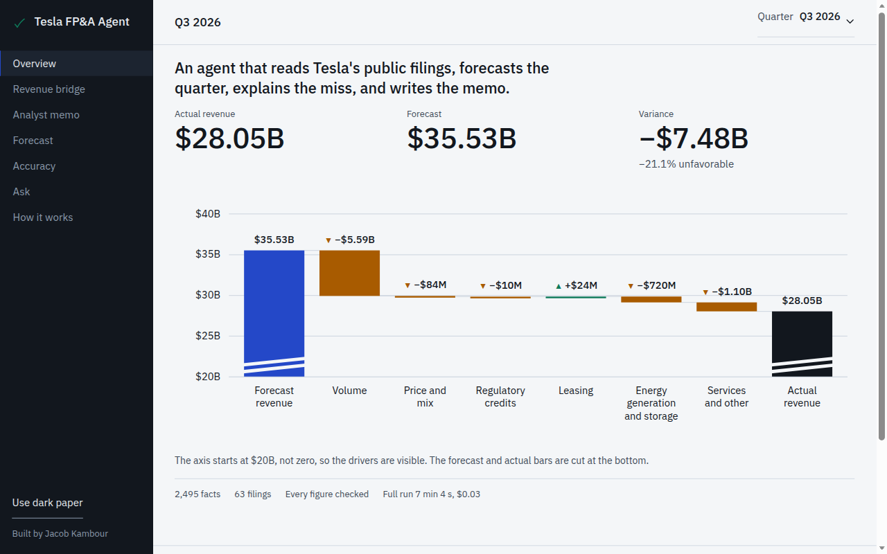
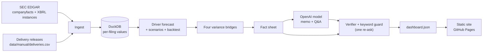

# Tesla FP&A Agent

Quarterly variance analysis is slow, manual work. An analyst rebuilds the forecast, ties the actuals to the 10-Q, breaks the miss into drivers, and writes the commentary, and every figure in that commentary has to be checked by hand before anyone trusts it. AI can draft the commentary in seconds, but finance cannot use numbers it cannot check. This project automates the whole loop on Tesla's public filings and makes the checking part of the product: code builds the forecast and the variance bridges, a model drafts the memo, and code verifies every figure the model wrote against the database before anything is published.

**Live dashboard:** https://kambourr.github.io/tesla-fpa-agent/ · **Plain-language write-up:** https://kambourr.github.io/tesla-fpa-agent/how-it-was-built.html



The Overview is the first screen. A sidebar opens the revenue bridge, memo, forecast, accuracy, Q&A, and how it works. How it works still has the in-browser verifier and the pipeline stages; you can change any figure the model wrote and watch the same rules, ported to the browser and tested case for case against the Python version, flag it.

## What it does

1. **Ingest.** Pulls Tesla's financials from the SEC (the companyfacts API plus each 10-Q and 10-K XBRL instance for the segment lines) and the quarterly delivery counts from Tesla's investor-relations releases. Every value keeps its filing, accession number, and date.
2. **Load.** Stores one value per metric, period, and filing in DuckDB, so a later restatement never overwrites what was first reported. The SQL lives in `sql/`.
3. **Forecast.** Builds a driver-based forecast for each of the last 12 quarters as of the day the previous quarter was filed, so the model never sees the quarter it is forecasting: deliveries, ASP, segment revenue, margins, opex, and capex, plus bull and bear scenarios.
4. **Explain.** Breaks each quarter's variance into four bridges that sum exactly to the total (revenue, gross profit, operating income, free cash flow), then has an OpenAI model draft a variance memo for every quarter and answers to ten fixed questions for the latest one, using only a sheet of computed figures.
5. **Verify.** Code checks every figure the model wrote against that sheet: within 0.5% for dollars, 0.1 points for percentages, and exact for vehicle counts (at the precision written). Anything off is flagged with the expected value, the model gets one chance to correct it, and whatever is still wrong is published as flagged, never quietly fixed. A keyword guard blocks buy/sell language and price targets.
6. **Publish.** Writes one JSON file that the static dashboard reads. Visitors never call the model.

## How accuracy is controlled

On the latest full run (November 5, 2026), every one of the 351 figures in the model's first drafts tied to the filings or the computed tables. Code sent one draft back for breaking a format rule (149 words, under the 150-word minimum), and the retry passed. The published commentary carries 361 figures across the 12 memos and the 10 answers: 361 tied, 0 flagged, 0 could not be traced. The pipeline records what it rejects in each first draft, so a miss would be shown, not hidden.

The model never sees raw filings. It receives a fact sheet: every citable number for the quarter, each with a key, a period, a unit, and its source filing. Each figure it writes must cite one of those keys, and the verifier looks it up and compares. On the dashboard every AI-written figure carries an auditor's tick mark: a green tick when it ties to the filing (click it to open the filing), an amber flag when it does not, and a question mark when it cannot be traced.

The forecast itself is shown honestly. Backtest accuracy across the 12 published quarters, as average absolute percent error:

| Line | Average absolute error |
|---|---|
| Total revenue | 17.1% |
| Gross profit | 20.6% |
| Operating income | 101.0% |

Operating income is a small number left over after large ones, so a modest revenue miss turns into a large percentage miss there. The dashboard shows every quarter, including the misses.

## Architecture



Code does everything except write prose: it ingests, forecasts, computes the bridges, verifies, and publishes. The model only drafts the memo and the answers, from the fact sheet.

## Run it yourself

Requirements: [uv](https://docs.astral.sh/uv/) and Node 22.

```bash
uv sync
cp .env.example .env   # fill in OPENAI_API_KEY and SEC_USER_AGENT (a contact string the SEC asks for)
uv run python -m agent run
```

Each stage also runs alone: `ingest`, `model`, `variance`, `narrate`, `verify`, `publish`. A full run from a clean checkout takes about seven minutes, almost all of it narration, and costs about $0.03 in model usage for 12 memos and 10 answers (measured in GitHub Actions on November 5, 2026). Unchanged quarters reuse their verified narratives from `data/narrative_cache.json`, so a later refresh only pays for new or changed quarters. Tests: `uv run pytest` and, in `site/`, `npm test`.

In GitHub, the **Refresh data** workflow runs the same pipeline from repository secrets and commits the new data, and the site redeploys.

## Limitations and assumptions

- Public data only: SEC filings and Tesla's investor-relations releases. Nothing else.
- The driver models are deliberately simple (seasonal deliveries, trailing averages, recent growth). The point is a transparent, auditable forecast, not the best possible one.
- Delivery counts are transcribed by hand from the first release of each quarter, with a source URL per row; they are validated on every run but not scraped.
- Leased vehicles are counted in total deliveries, so the revenue bridge's volume bar treats a leased unit like a sold one.
- Forecasts are published only for quarters that have already been reported (a backtest). A forward forecast exists behind a flag and is off.

## Disclaimer

Independent analysis built from Tesla's public SEC filings and investor-relations releases. Not affiliated with or endorsed by Tesla, Inc. Not investment advice.

Designed and built by Jacob Kambour.
